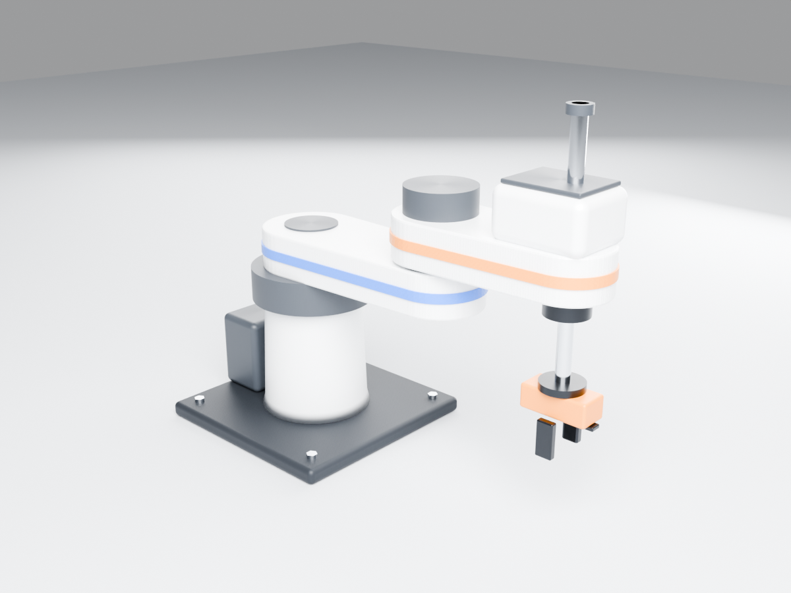
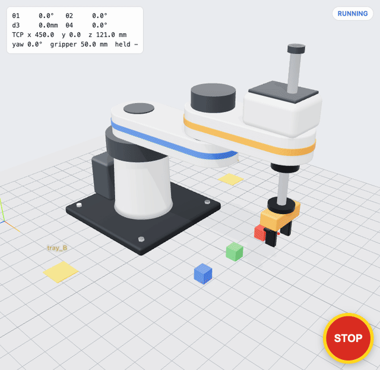
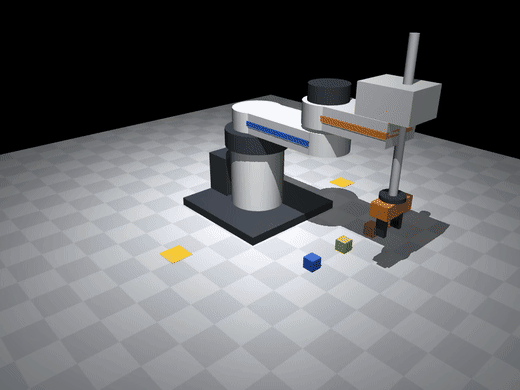
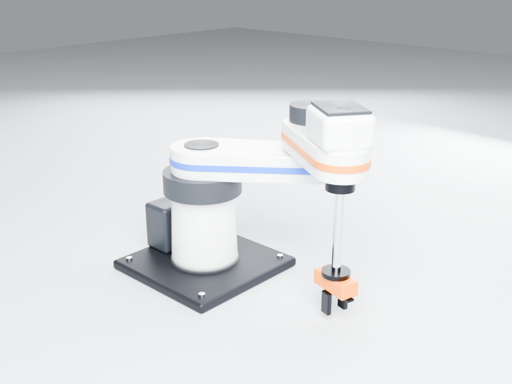
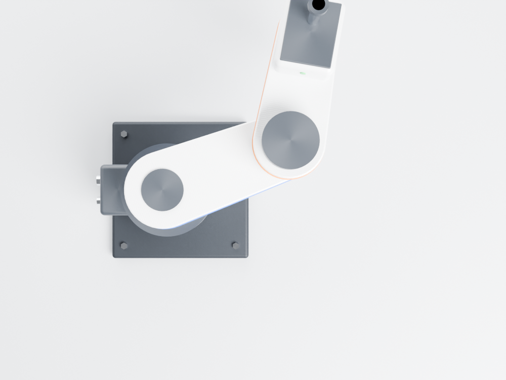
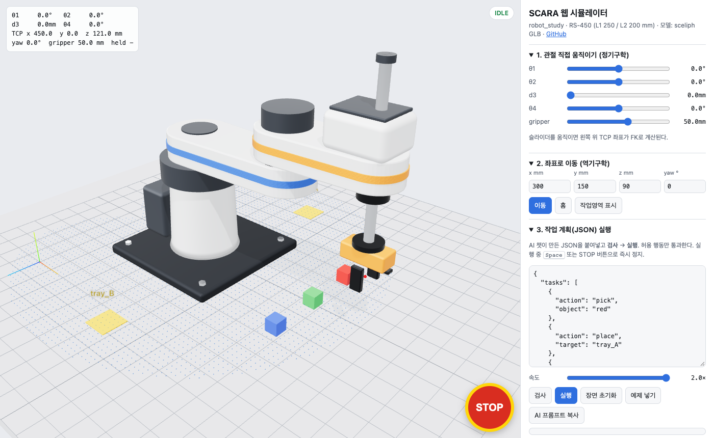
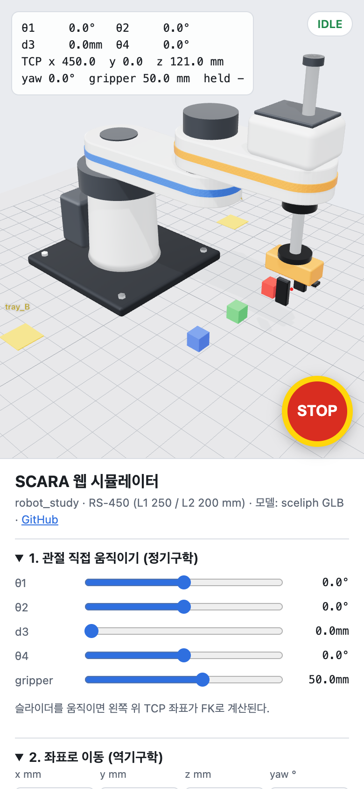
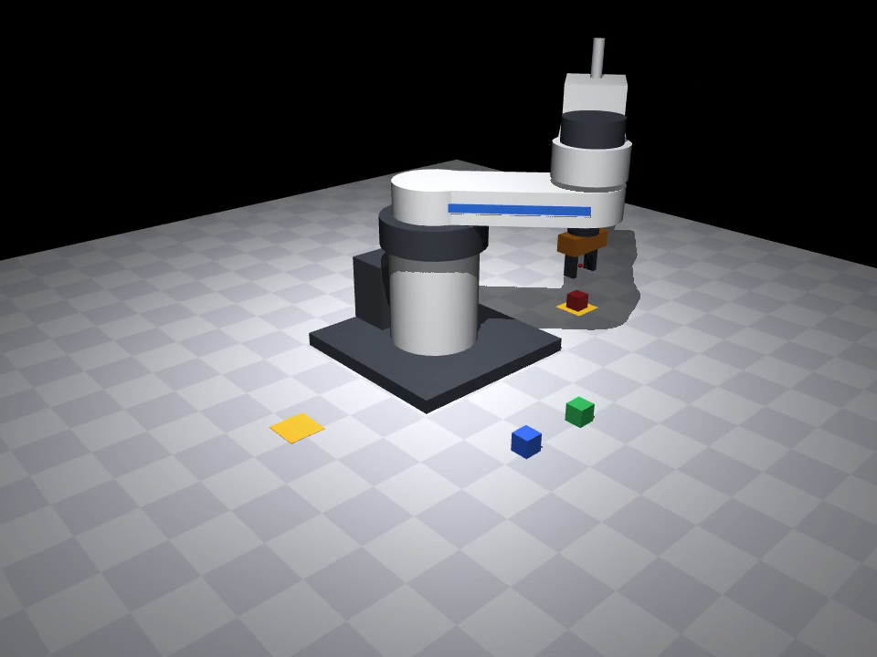

<div align="center">

# robot_study

### SCARA 로봇 핸즈온 세미나 · 설치 없이 브라우저와 AI 챗만으로 따라 하기

**모델링(sceliph GLB) → 정기구학 → 역기구학 → 궤적 → 픽앤플레이스 → 자연어 작업 계획 + 안전 게이트**

     [](LICENSE)



**RS-450 학습용 SCARA** · sceliph로 컴파일한 GLB를 Blender 5.2 Cycles로 렌더한 이미지 (실물 아님)

[**▶ 웹 시뮬레이터 열기**](https://djfksjd.github.io/robot_study/) · [GLB 다운로드](#1-glb-모델-다운로드) · [커리큘럼](#3-커리큘럼-lab-08) · [프롬프트 모음](prompts/README.md) · [강사 가이드](seminar/README.md)

</div>

---

## 이 저장소로 할 수 있는 것

| | 내용 | 실행 위치 |
|---|---|---|
| 🧩 | SCARA GLB 모델을 내려받아 관절 계층을 직접 움직여 본다 | 브라우저 / Blender |
| 📐 | 정기구학·역기구학 식을 유도하고 코드로 검산한다 | Google Colab |
| 📈 | 관절 보간과 직선 보간의 경로 차이를 그래프로 본다 | Google Colab |
| 🤖 | 웹 시뮬레이터에서 블록 3개를 집어 옮기고 쌓는다 | 브라우저 |
| 🛑 | 잘못된 작업 계획이 **실행 전에 전부 거부**되고, STOP이 즉시 멈추는 것을 확인한다 | 브라우저 |
| 🗣️ | 상용 AI 챗이 자연어 명령을 **허용 행동 JSON**으로 바꾸게 하고, 게이트가 최종 판단하게 한다 | AI 챗 + 브라우저 |
| ⚙️ | 같은 계획을 마찰·접촉이 있는 MuJoCo 물리 엔진에서 실행해 파지 조건을 실험한다 | Google Colab |
| 🛠️ | (심화) 치수 하나를 바꾸면 GLB·기구학·시뮬레이터가 함께 바뀌는 파이프라인을 돌려 본다 | 로컬 PC |

| 웹 시뮬레이터 픽앤플레이스 (타임랩스) | MuJoCo 물리 시뮬레이션 (1배속) |
|---|---|
|  |  |
| 안전 게이트 통과 → 7개 작업 → 완료. [스크린샷](media/web_sim_running.png) | 빨강·초록 tray_A 적층, 파랑 tray_B. 최종 오차 약 1.5 mm. [MP4](media/mujoco_pick_place.mp4) |

---

## 0. 빠른 시작 (5분)

준비물은 **노트북 PC + Chrome/Edge + Google 계정 + AI 챗 계정 1개**(ChatGPT, Claude, Gemini 등)뿐이다.

1. **AI 챗**을 새로 열고 [`prompts/00_tutor_system.md`](prompts/00_tutor_system.md)의 프롬프트를 붙여넣는다 → "튜터 모드 준비 완료"
2. **웹 시뮬레이터** <https://djfksjd.github.io/robot_study/> 를 연다 → `3. 작업 계획` 의 **실행** → 블록이 옮겨지는지 본다
3. **Colab** 노트북을 연다 → `런타임 → 모두 실행`

   | 노트북 | Colab |
   |---|---|
   | Lab 2 · 정기구학·작업 영역 | [](https://colab.research.google.com/github/djfksjd/robot_study/blob/main/notebooks/01_forward_kinematics_workspace.ipynb) |
   | Lab 3–4 · 역기구학·궤적 | [](https://colab.research.google.com/github/djfksjd/robot_study/blob/main/notebooks/02_inverse_kinematics_trajectory.ipynb) |
   | Lab 6 · MuJoCo 물리 픽앤플레이스 | [](https://colab.research.google.com/github/djfksjd/robot_study/blob/main/notebooks/03_mujoco_pick_place.ipynb) |

그다음은 [커리큘럼](#3-커리큘럼-lab-08) 순서대로, 각 Lab의 프롬프트 파일을 위에서부터 하나씩 AI 챗에 붙여넣으며 진행한다.

---

## 1. GLB 모델 다운로드

| 파일 | 설명 | 받기 |
|---|---|---|
| **`scara_rigged.glb`** | 학생용 기본. 관절 노드(joint1~4, finger_*) 계층 포함 | [raw 다운로드](https://github.com/djfksjd/robot_study/raw/main/models/scara/scara_rigged.glb) |
| `scara_sceliph_flat.glb` | sceliph 컴파일 원본(부품 31개, 평면 구조, 홈 자세) | [raw 다운로드](https://github.com/djfksjd/robot_study/raw/main/models/scara/scara_sceliph_flat.glb) |
| `scara.assembly.json` | sceliph AssemblyIR 원본 — 편집 가능한 선언형 형상 | [보기](model/scara.assembly.json) |

[Releases](https://github.com/djfksjd/robot_study/releases)에도 같은 파일을 첨부했다. 상세 규격·노드 표·three.js 예제는 [`models/scara/README.md`](models/scara/README.md).

**여는 방법**

- 설치 없이: <https://gltf-viewer.donmccurdy.com/> 에 파일을 끌어다 놓기
- 웹 시뮬레이터: 같은 GLB를 불러와 관절을 움직인다
- Blender 4.x 이상: `File → Import → glTF 2.0`. 아웃라이너에서 `joint1`을 선택하고 Z 회전을 바꿔 본다

| 자세 예 (θ1 35°, θ2 −70°, d3 90 mm, θ4 20°, 간격 34 mm) | 위에서 본 모습 (θ1 20°, θ2 60°) |
|---|---|
|  |  |

---

## 2. 로봇 사양 — RS-450 학습용 SCARA

모든 값의 단일 기준은 [`model/scara_params.json`](model/scara_params.json)이다. 모델 생성기, Python 기구학, MuJoCo, 웹 시뮬레이터가 이 파일 하나를 읽는다.

| 항목 | 값 |
|---|---|
| 구성 | 회전 θ1 · 회전 θ2 · 수직 직동 d3 · 회전 θ4 (4축) + 평행 2지 그리퍼 |
| 링크 길이 | L1 = 250 mm, L2 = 200 mm |
| J1 높이 | 250 mm (베이스 바닥 기준) |
| 작업 반경 | 143.5 ~ 450 mm (θ2 한계 ±145°에서 안쪽 반경이 생김) |
| 관절 한계 | θ1 ±132°, θ2 ±145°, d3 0~180 mm, θ4 ±360°, 그리퍼 간격 20~70 mm |
| 최고 속도 | θ1 180°/s, θ2 240°/s, d3 300 mm/s, θ4 360°/s, 그리퍼 60 mm/s |
| TCP | 두 손가락 패드 중심. **z = 121 − d3** (mm), **yaw = θ1 + θ2 + θ4** |
| 좌표계 | 로봇 좌표 Z-up, X 앞, Y 왼쪽, 원점 = 베이스 바닥 중심(작업대 표면). 각도는 위에서 볼 때 반시계가 + |
| glTF 변환 | 로봇 `(x, y, z)` mm → glTF `(x, z, −y) / 1000` m |

**정기구학**

```text
x   = L1·cos θ1 + L2·cos(θ1 + θ2)
y   = L1·sin θ1 + L2·sin(θ1 + θ2)
z   = 121 − d3
yaw = θ1 + θ2 + θ4
```

**역기구학**

```text
c2 = (x² + y² − L1² − L2²) / (2·L1·L2)         |c2| > 1 이면 도달 불가 → 거부
θ2 = atan2(±√(1 − c2²), c2)                     − : 오른팔(elbow right), + : 왼팔(elbow left)
θ1 = atan2(y, x) − atan2(L2·sin θ2, L1 + L2·cos θ2)
d3 = 121 − z,  θ4 = yaw − θ1 − θ2              관절 한계 밖이면 거부
```

구현: [`python/scara_kinematics.py`](python/scara_kinematics.py) (Python) · [`docs/sim.js`](docs/sim.js) (JavaScript, 같은 식)

---

## 3. 커리큘럼 (Lab 0~8)

| Lab | 주제 | 실행 | 프롬프트 | 완료 기준 |
|---|---|---|---|---|
| 0 | SCARA 구조와 4축의 역할 | AI 챗 | [01](prompts/01_scara_concept.md) | 4축이 TCP의 x·y·z·yaw 중 무엇을 바꾸는지 표로 설명 |
| 1 | GLB 모델 열기, 관절 노드 계층 | 브라우저 / Blender | [02](prompts/02_glb_model.md) | joint1~4, finger_* 노드를 찾고 자세를 바꿈 |
| 2 | 정기구학, 작업 영역 | Colab [노트북 01](notebooks/01_forward_kinematics_workspace.ipynb) | [03](prompts/03_forward_kinematics.md) | 손계산 = `robot.fk` = 웹 HUD 값 |
| 3 | 역기구학, 두 팔꿈치 해, 거부할 목표 | Colab [노트북 02](notebooks/02_inverse_kinematics_trajectory.ipynb) | [04](prompts/04_inverse_kinematics.md) | 직접 짠 IK가 무작위 1000개 역검산 통과, 거부 4종 확인 |
| 4 | 궤적: 관절 보간 vs 직선 보간, 속도 한계 | Colab 노트북 02 | [05](prompts/05_trajectory.md) | 직선 보간이 실패하는 예를 실행으로 확인 |
| 5 | 웹 시뮬레이터 픽앤플레이스, 안전 게이트, STOP | 브라우저 | [06](prompts/06_web_sim_task_json.md) | 예제 성공 + 거부 계획 5개 전부 거부 + STOP 3경우 기록 |
| 6 | MuJoCo 물리 픽앤플레이스, 파지 조건 실험 | Colab [노트북 03](notebooks/03_mujoco_pick_place.ipynb) | [08](prompts/08_mujoco_physics.md) | 기본 계획 PASS, 변수 실험 3회 이상 기록 |
| 7 | 자연어 → 허용 행동 JSON, 프롬프트 주입 시험 | AI 챗 + 브라우저 | [07](prompts/07_natural_language_planner.md) | 명령 시험표 7개 기록, 주입을 게이트가 막는 것 확인 |
| 8 | (심화) 치수 변경 → GLB 재생성 | 로컬 PC | [09](prompts/09_modify_model_sceliph.md) | L2를 바꾸면 GLB·웹·MuJoCo가 함께 바뀜 |
| 공통 | 오류 해석 · 보고서 | AI 챗 | [10](prompts/10_debug_helper.md) · [11](prompts/11_lab_report.md) | [보고서 양식](seminar/lab_report_template.md) |

3시간 집중형·2일형 시간표, 사전 점검표, 평가 예시는 [`seminar/README.md`](seminar/README.md)에 있다.

### Lab별 요약

<details>
<summary><b>Lab 0–1 · 구조와 모델</b></summary>

SCARA는 수평면에서는 유연하고 수직 방향으로는 단단한(Selective Compliance) 구조라 위에서 내려 꽂는 조립·픽앤플레이스에 강하다. 공구는 항상 수직이라 roll·pitch를 바꿀 수 없다. GLB에서 `joint1 → joint2 → joint3 → joint4 → finger_*` 계층을 찾고, 부모 회전이 자식 부품 전체를 움직이는 것을 확인한다.
</details>

<details>
<summary><b>Lab 2 · 정기구학과 작업 영역</b></summary>

`q=(0°, 90°, 0, 0)` → `(250, 200, 121, 90°)`, `q=(90°, −90°, 50 mm, 30°)` → `(200, 250, 71, 30°)`를 손으로 먼저 풀고 코드로 검산한다. 관절 공간을 무작위로 뽑아 작업 영역을 그리면 안쪽 반경 143.5 mm의 빈 원과 뒤쪽의 빈 부채꼴이 보인다.


</details>

<details>
<summary><b>Lab 3–4 · 역기구학과 궤적</b></summary>

같은 (x, y)에 팔꿈치 해가 2개다. 아래 목표는 모두 **거부**되어야 한다(저장소 코드로 실행 확인).

| 목표 (x, y, z) | 결과 |
|---|---|
| (500, 0, 50) | 도달 불가: 반경 500 mm |
| (50, 50, 50) | θ2 = 167.2° 한계 초과 |
| (300, 0, −100) | d3 = 221 mm 한계 초과 |
| (−300, −10, 50) | θ1 = 140.5° 한계 초과 |

5차 다항식 `s = 10τ³ − 15τ⁴ + 6τ⁵`로 시작·끝 속도와 가속도를 0으로 만들고, 최고 속도 = 1.875 × 평균 속도로 최소 이동 시간을 정한다. `(120, 100) → (120, −100)` 직선은 양 끝은 닿지만 중간점(반경 120 mm)이 안쪽 빈 원에 들어가 실패한다.
</details>

<details>
<summary><b>Lab 5 · 웹 시뮬레이터</b></summary>

[웹 시뮬레이터](https://djfksjd.github.io/robot_study/)는 sceliph GLB를 three.js로 불러와 관절 노드를 직접 움직인다.

- **1. 관절 직접 움직이기**: 슬라이더 → HUD에 FK 결과
- **2. 좌표로 이동**: x, y, z, yaw → IK로 이동, **작업영역 표시**(IK가 성공하는 점만 표시)
- **3. 작업 계획(JSON)**: 붙여넣기 → **검사** → **실행**. 속도 0.2~2배. **AI 프롬프트 복사**는 현재 블록 위치가 들어간 계획기 프롬프트를 클립보드에 넣는다
- **STOP**(빨간 원, `Space`): 실행 중 즉시 정지하고 남은 작업을 취소한다



**허용 행동**

```json
{"action": "home"}
{"action": "move_to", "x": 300, "y": 0, "z": 90, "yaw_deg": 0}
{"action": "open_gripper"}
{"action": "close_gripper"}
{"action": "pick", "object": "red"}
{"action": "place", "target": "tray_A"}
{"action": "wait", "seconds": 1}
{"action": "stop"}
```

물체 `red (330, 120)`, `green (330, 0)`, `blue (330, −120)` · 목표 `tray_A (60, 330)`, `tray_B (60, −330)` · 블록 30 mm. 장면 정의: [`model/task_scene.json`](model/task_scene.json)

**안전 게이트(실행 전 정적 검사)** — 하나라도 걸리면 계획 **전체**를 거부하고 아무것도 움직이지 않는다.

- JSON 형식 `{"tasks": [...]}`, 작업 1~60개
- 허용 목록 밖의 행동, 필수 필드 누락, 숫자가 아닌 값
- 장면에 없는 물체·목표
- `move_to`의 IK 실패(반경·관절 한계), z < 15 mm(작업대 충돌)
- 잡은 상태에서 `pick`, 빈손으로 `place`, `wait` 0~10초 밖
- 실행 중에도: 위에 다른 블록이 있는 블록 `pick`, 파지 실패 → 즉시 안전 정지

<br clear="right" />

> 이 시뮬레이터는 **운동학 시뮬레이션**이다. 손가락 사이에 블록이 있으면 그리퍼에 붙이는 방식이라 마찰·미끄러짐이 없다. 물리 검증은 Lab 6에서 한다.
</details>

<details>
<summary><b>Lab 6 · MuJoCo 물리</b></summary>

[`sim/mujoco/scara.xml`](sim/mujoco/scara.xml)은 `scara_params.json`에서 자동 생성한 MJCF다(외형은 단순 도형). 손가락은 위치 제어 + 힘 제한(15 N)으로 블록을 **마찰로** 쥔다. 웹 시뮬레이터와 같은 JSON 계획을 [`sim/mujoco/pick_place.py`](sim/mujoco/pick_place.py)가 실행한다.

```bash
pip install mujoco imageio imageio-ffmpeg
python3 sim/mujoco/pick_place.py                    # 물리만, 결과 판정
python3 sim/mujoco/pick_place.py --video out.mp4    # 영상 저장
python3 sim/mujoco/pick_place.py --plan my_plan.json
```

기본 계획 실행 결과(macOS arm64, MuJoCo 3.17.0): 시뮬레이션 20.5 s, `red (60.5, 328.7, 14.9)`, `green (60.8, 328.7, 44.9)`, `blue (60.4, −331.3, 15.0)` mm.



실험 과제: `grip_closed_mm`(쥐는 깊이), 패드 마찰계수, 블록 질량을 **하나씩** 바꿔 성공 조건을 찾는다.
</details>

<details>
<summary><b>Lab 7 · 자연어 → 허용 행동 JSON</b></summary>

```text
사람 명령 ──▶ AI 챗(계획기) ──▶ JSON ──▶ 안전 게이트 ──▶ 실행기 ──▶ 로봇
                                          │ 거부 → 아무것도 하지 않음
STOP ──────────────────────────────────────────────────────▶ 즉시 정지 (AI를 거치지 않음)
```

1. AI는 모터 명령을 만들지 않는다. 정해진 행동 목록에서 **고르기만** 한다.
2. 최종 판단은 코드(안전 게이트)가 한다.
3. STOP은 AI를 거치지 않고 항상 우선한다.

명령 시험표(정상·모호·위험·장면에 없는 물체·반경 밖)와 프롬프트 주입 시험은 [`prompts/07_natural_language_planner.md`](prompts/07_natural_language_planner.md). 결론은 "AI가 막아야 한다"가 아니라 **"AI가 뚫려도 게이트가 막는다"**이다.
</details>

<details>
<summary><b>Lab 8 · 모델 다시 만들기 (심화)</b></summary>

아래 [모델 제작 파이프라인](#5-모델-제작-파이프라인-sceliph)을 직접 돌린다. `L2`를 230 mm로 바꾸고 `scripts/build_all.sh`를 실행하면 GLB, 웹 시뮬레이터, MuJoCo, 기구학 테스트가 한 번에 갱신된다.
</details>

---

## 4. 상용 AI 챗만으로 따라 하는 법

AI 챗은 **설명·코드 작성·오류 해석·작업 계획 JSON 생성**을 맡고, 실행은 브라우저와 Colab이 맡는다. 프롬프트는 [`prompts/`](prompts/README.md)에 실습별로 하나씩 들어 있다.

| 순서 | 하는 일 |
|---|---|
| 1 | 새 대화 → [`00_tutor_system.md`](prompts/00_tutor_system.md) 붙여넣기 (로봇 치수·좌표계·답변 규칙 고정) |
| 2 | Lab 프롬프트를 위에서부터 하나씩 붙여넣기. `<<…>>` 표시는 내 값으로 바꾸기 |
| 3 | AI가 준 코드는 Colab 셀에, 계획 JSON은 웹 시뮬레이터에 붙여넣고 **실행해서 확인** |
| 4 | 결과(숫자·오류·스크린샷)를 다시 AI에게 붙여넣고 다음 단계 |
| 5 | 막히면 [`10_debug_helper.md`](prompts/10_debug_helper.md), 마무리는 [`11_lab_report.md`](prompts/11_lab_report.md) |

규칙: AI 답변은 제안일 뿐이다. 숫자·그래프·로그로 확인하고, 보고서에 **"AI가 틀린 점"** 칸을 채운다. 계정 키·개인정보는 붙여넣지 않는다.

---

## 5. 모델 제작 파이프라인 (sceliph)

GLB는 [sceliph](https://github.com/djfksjd/sceliph)(선언형 IR → 로컬 기하 엔진 → GLB, Apache-2.0)로 만들었다. 외부 유료 3D 생성 API를 쓰지 않는다.

```text
model/scara_params.json ──▶ model/build_scara_ir.py ──▶ model/scara.assembly.json   (sceliph AssemblyIR, 부품 31개)
                                                              │ sceliph scripts/export-assembly-glb.ts
                                                              ▼
                                               models/scara/scara_sceliph_flat.glb (홈 자세, 평면 구조)
                                                              │ tools/rig_scara_glb.mjs  (부품 id 접두어 → 관절 노드)
                                                              ▼
                                               models/scara/scara_rigged.glb ──▶ docs/ (웹 시뮬레이터)
model/scara_params.json ──▶ sim/mujoco/build_mjcf.py ──▶ sim/mujoco/scara.xml
model/scara_params.json ──▶ python/scara_kinematics.py, docs/sim.js
```

- 형상 연산: `roundedBox`(베이스·헤드·그리퍼), `cylinder`(하우징·축), `lathe`(베이스 기둥), `extrude`(두 원을 외접선으로 이은 링크 단면, 베벨 3 mm)
- 재질: 도장 알루미늄(clearcoat), 크롬 축(polished-metal, anisotropy), 양극산화 손가락, 우레탄 패드 등 sceliph `material.surface` 지정
- 부품 id 접두어 `base__ / link1__ / link2__ / quill__ / fingerL__ / fingerR__`가 리깅 그룹이다

**다시 만들기**

```bash
git clone https://github.com/djfksjd/robot_study.git && cd robot_study
git clone https://github.com/djfksjd/sceliph.git ../sceliph && (cd ../sceliph && npm install)
pip install -r requirements.txt
# model/scara_params.json 수정 (예: "L2": 230)
SCELIPH_DIR=../sceliph scripts/build_all.sh
```

`build_all.sh`: IR 생성 → GLB 컴파일 → 리깅 → docs 동기화 → MJCF 생성 → 기구학 테스트 → (mujoco 있으면) 픽앤플레이스.
README 이미지 렌더: `blender --background --python tools/blender_render.py -- models/scara/scara_rigged.glb media/out.png --theta1 30 --theta2 -60 --d3 80`

---

## 6. 저장소 구조

```text
robot_study/
├── README.md                     이 문서
├── docs/                         웹 시뮬레이터 (GitHub Pages)
│   ├── index.html, sim.js        three.js r179, 기구학·안전 게이트·STOP·실행기
│   ├── models/scara_rigged.glb   (tools/sync_docs.sh 가 복사)
│   └── scara_params.json, task_scene.json
├── models/scara/                 학생 다운로드용 GLB + 규격 문서
├── model/                        단일 기준값과 모델 생성기
│   ├── scara_params.json         치수·관절 한계·속도 (모든 도구가 읽음)
│   ├── task_scene.json           블록·트레이·허용 행동 (웹·MuJoCo 공유)
│   ├── build_scara_ir.py         params → sceliph AssemblyIR
│   └── scara.assembly.json       생성된 IR
├── python/                       scara_kinematics.py (FK/IK/궤적), 테스트
├── notebooks/                    Colab 노트북 3개 (tools/make_notebooks.py 로 생성)
├── sim/mujoco/                   build_mjcf.py → scara.xml, pick_place.py
├── prompts/                      상용 AI 챗용 프롬프트 00~11
├── seminar/                      강사 가이드, 보고서 양식
├── tools/                        GLB 리깅·검사, Blender 렌더, docs 동기화
├── scripts/build_all.sh          전체 재생성
└── media/                        README 이미지·GIF·영상 (실제 실행 결과)
```

---

## 7. 검증 기록 (2026-10-28, macOS arm64)

**실제로 실행해 확인한 것**

| 항목 | 결과 |
|---|---|
| sceliph GLB 컴파일 | 부품 31개, 삼각형 15,336개 |
| Khronos glTF Validator 2.0.0-dev.3.10 | `scara_sceliph_flat.glb`, `scara_rigged.glb` 모두 오류 0 · 경고 0 |
| Blender 5.2.1 가져오기·자세 변경·렌더 | 성공 (README 이미지) |
| Python 기구학 테스트 5종 | PASS (FK↔IK 무작위 2000개 왕복, 도달 불가·d3 한계 거부, 궤적 끝점·직선성) |
| MuJoCo 3.17.0 기본 계획 | 7개 작업 성공, 블록 최종 오차 약 1.5 mm 이내 |
| 노트북 3개 로컬 실행 (nbclient) | 오류 0, 노트북 03 판정 PASS |
| 웹 시뮬레이터 (Chrome 헤드리스) | 잘못된 계획 거부(없는 물체·반경 밖·허용 외 행동) 후 무동작, 예제 7개 작업 완료, `Space` STOP 후 관절값 고정, 390 px 폭 가로 스크롤 없음, 콘솔 오류 0 |

**아직 확인하지 않은 것**

- Google Colab 실제 런타임에서의 실행(특히 노트북 03의 `MUJOCO_GL=egl` 영상 렌더) — 세미나 전 [사전 점검표](seminar/README.md#강사-사전-점검-세미나-전날)로 확인 필요
- 각 상용 AI 챗(ChatGPT·Claude·Gemini)이 프롬프트에 기대대로 답하는지 — 모델마다 다르며, 그 차이를 기록하는 것이 실습의 일부다
- Safari·Firefox, 태블릿에서의 웹 시뮬레이터 동작

---

## 8. 한계

- 모델은 **창작 학습용 형상**이다. 특정 제품의 복제나 실측 모델이 아니며 모터·감속기·케이블 내부 구조가 없다.
- 웹 시뮬레이터는 운동학(파지는 조건 충족 시 부착), MuJoCo는 단순 도형과 단순화된 접촉 모델이다. **시뮬레이션 성공은 실제 로봇 성능이 아니다.**
- 동역학(토크·관성)·충돌 회피 경로 계획·비전은 다루지 않는다. 확장 과제로 남긴다.

## 9. 라이선스와 출처

- 코드: [MIT](LICENSE) · 모델·이미지·프롬프트·세미나 문서: MIT 또는 CC BY 4.0
- [sceliph](https://github.com/djfksjd/sceliph) — Apache-2.0 (GLB 컴파일 엔진, 이 저장소에 포함하지 않음)
- [three.js](https://threejs.org/) r179 — MIT (CDN 로드) · [MuJoCo](https://mujoco.org/) — Apache-2.0 · [glTF-Transform](https://gltf-transform.dev/) — MIT
